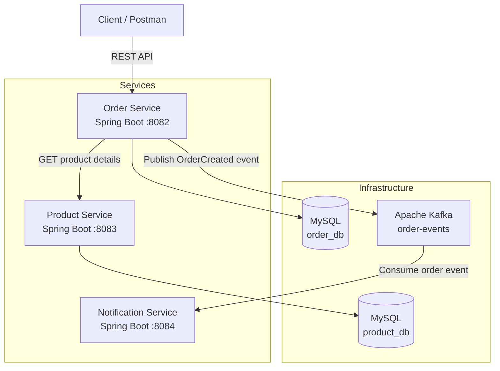

# Event-Driven Order Management System

A microservices-based order management system built with Java, Spring Boot, Apache Kafka, and MySQL. The project demonstrates synchronous REST communication between services and asynchronous event-driven processing.

## Overview

The application is composed of three independent microservices:

- **Product Service:** manages product information and exposes REST APIs.
- **Order Service:** creates orders, retrieves product details, validates stock availability, calculates order totals, and persists orders.
- **Notification Service:** consumes order events from Apache Kafka to process notifications asynchronously.

The services use MySQL for persistence, while Apache Kafka enables asynchronous communication between order processing and notification handling.

## Architecture



## Order Processing Workflow

1. The client submits an order through the Order Service REST API.
2. The Order Service retrieves product details from the Product Service.
3. The service checks stock availability and calculates the total price.
4. The order is saved in the order database with the `CREATED` status.
5. An `OrderCreated` event is published to the Kafka topic `order-events`.
6. The Notification Service consumes the event for asynchronous notification processing.

## Technology Stack

| Technology | Purpose |
|---|---|
| Java | Backend development |
| Spring Boot | Microservice implementation |
| Spring Web / REST | HTTP APIs and inter-service communication |
| Spring Data JPA | Database persistence |
| MySQL | Relational data storage |
| Apache Kafka | Event-driven messaging |
| Maven | Dependency management and builds |
| Docker | Running infrastructure containers |
| Postman | API testing |
| Git / GitHub | Version control |

## Services and Ports

| Service | Port | Responsibility |
|---|---:|---|
| Order Service | `8082` | Order creation and management |
| Product Service | `8083` | Product management |
| Notification Service | `8084` | Kafka event consumption |
| Kafka | `9092` | Asynchronous messaging |
| Product MySQL | `3306` | Product database |
| Order MySQL | `3307` | Order database |

## Prerequisites

- JDK compatible with the project's Spring Boot configuration
- Maven
- Docker Desktop
- Postman or another HTTP client

## Infrastructure Setup

### 1. Start the MySQL databases

Create the Product database:

```powershell
docker run --name product-mysql `
  -e MYSQL_DATABASE=product_db `
  -e MYSQL_ROOT_PASSWORD=root `
  -p 3306:3306 `
  -d mysql:8.4
```

Create the Order database:

```powershell
docker run --name order-mysql `
  -e MYSQL_DATABASE=order_db `
  -e MYSQL_ROOT_PASSWORD=root `
  -p 3307:3306 `
  -d mysql:8.4
```

### 2. Start Apache Kafka

For local development, run the Kafka image:

```powershell
docker run -d `
  --name kafka `
  -p 9092:9092 `
  apache/kafka:4.3.1
```

Verify the container status:

```powershell
docker ps
```

Ensure that Kafka is reachable at `localhost:9092` from the Spring Boot applications.

### 3. Create the Kafka topic

```powershell
docker exec -it kafka /opt/kafka/bin/kafka-topics.sh `
  --create `
  --topic order-events `
  --bootstrap-server localhost:9092 `
  --partitions 3 `
  --replication-factor 1
```

If the topic already exists, it does not need to be created again.

## Configuration

Configure each service in its own `src/main/resources/application.properties` file.

### Product Service

```properties
spring.application.name=product-service
server.port=8083

spring.datasource.url=jdbc:mysql://localhost:3306/product_db
spring.datasource.username=root
spring.datasource.password=root

spring.jpa.hibernate.ddl-auto=update
spring.jpa.show-sql=true
```

### Order Service

```properties
spring.application.name=order-service
server.port=8082

spring.datasource.url=jdbc:mysql://localhost:3307/order_db
spring.datasource.username=root
spring.datasource.password=root

spring.jpa.hibernate.ddl-auto=update
spring.jpa.show-sql=true

spring.kafka.bootstrap-servers=localhost:9092
```

Use environment variables or a local, untracked configuration file for credentials in production. Do not commit real passwords or secrets.

## Running the Services

Start each service in a separate terminal.

### Product Service

```powershell
cd product-service
mvn spring-boot:run
```

### Order Service

```powershell
cd order-service
mvn spring-boot:run
```

### Notification Service

```powershell
cd notification-service
mvn spring-boot:run
```

Ensure that each service has its required dependencies and its configured port is available before starting it.

## API Endpoints

### Product Service

| Method | Endpoint | Description |
|---|---|---|
| `GET` | `/api/products` | Retrieve all products |
| `GET` | `/api/products/{id}` | Retrieve a product by ID |
| `POST` | `/api/products` | Create a product |

Example product creation request:

```http
POST http://localhost:8083/api/products
Content-Type: application/json
```

```json
{
  "name": "Laptop",
  "price": 1200.00,
  "stock": 10
}
```

### Order Service

| Method | Endpoint | Description |
|---|---|---|
| `GET` | `/api/orders` | Retrieve all orders |
| `GET` | `/api/orders/{id}` | Retrieve an order by ID |
| `POST` | `/api/orders` | Create an order |

Example order creation request:

```http
POST http://localhost:8082/api/orders
Content-Type: application/json
```

```json
{
  "productId": 1,
  "quantity": 2
}
```

The referenced product must exist and have sufficient stock.

A successful response should include the generated order ID, product ID, quantity, total price, and order status.

## Event-Driven Communication

When an order is created, the Order Service publishes an `OrderCreated` event containing information such as:

- Order ID
- User ID
- Product ID
- Quantity
- Total price

The event is sent to the Kafka topic:

```text
order-events
```

The Notification Service subscribes to this topic and processes incoming order events independently of the REST request.

## Key Concepts Demonstrated

- Microservices architecture
- RESTful API design
- Synchronous inter-service communication
- Asynchronous messaging with Apache Kafka
- Event-driven architecture
- Relational persistence with MySQL and Spring Data JPA
- Separation of concerns using controllers, services, repositories, DTOs, and event components
- Containerized development infrastructure

## Future Improvements

- Add centralized authentication and authorization with Keycloak and JWT.
- Replace the temporary hardcoded user ID with the authenticated user's identity.
- Implement stock reservation and inventory updates.
- Introduce the Transactional Outbox pattern for more reliable event publishing.
- Add automated unit and integration tests.
- Add Docker Compose orchestration and health checks.
- Implement structured logging, monitoring, and API documentation.

## Project Status

Developed as a hands-on project to explore Spring Boot microservices, distributed application design, and event-driven communication.

**Note:** Authentication, reliable event delivery, stock reservation, and production-grade deployment are planned improvements and should not be considered implemented until completed and tested.
